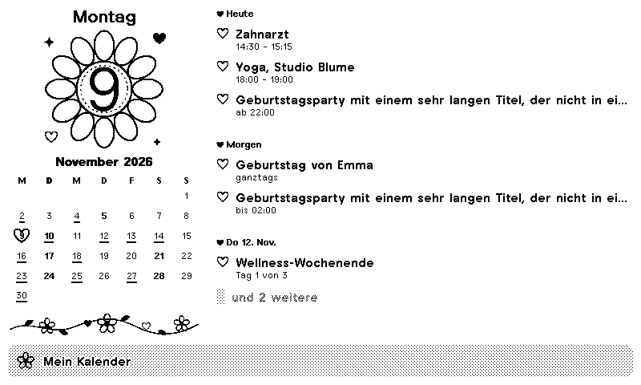
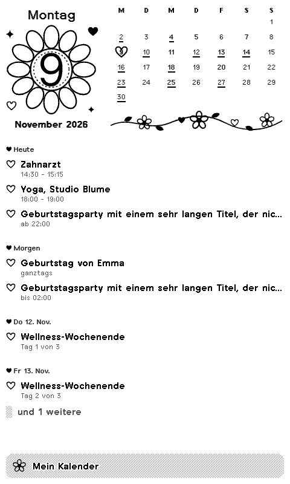
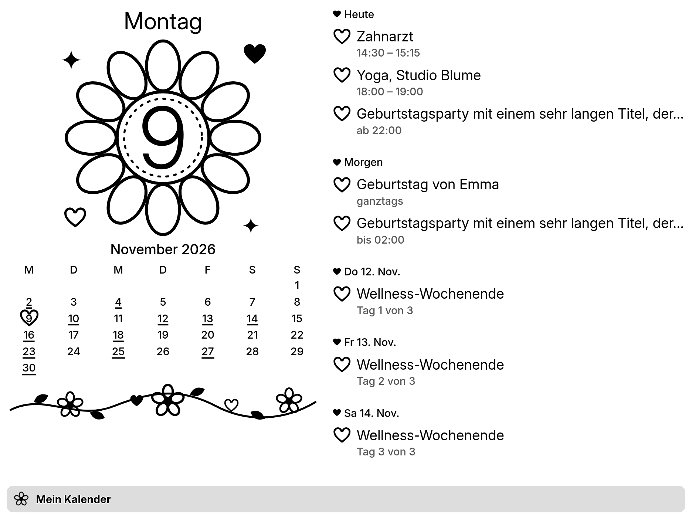
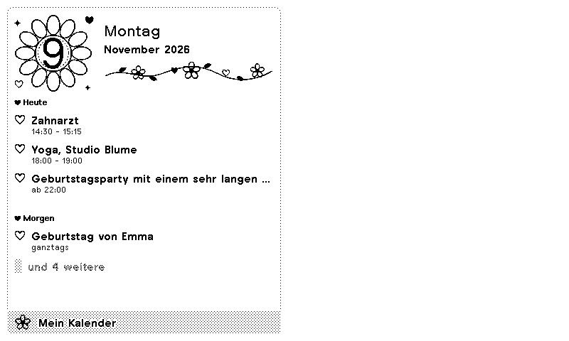
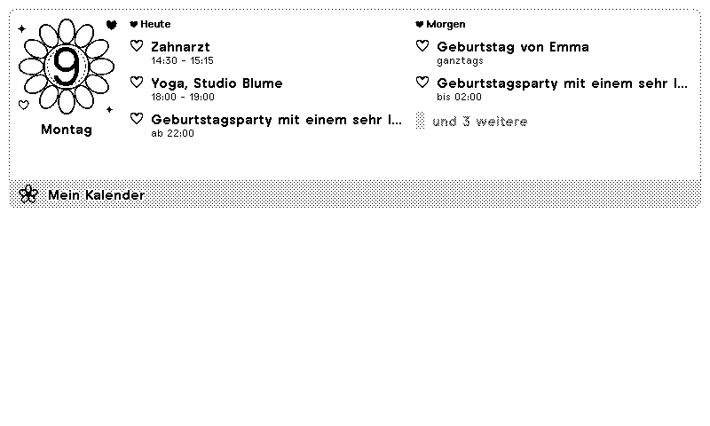
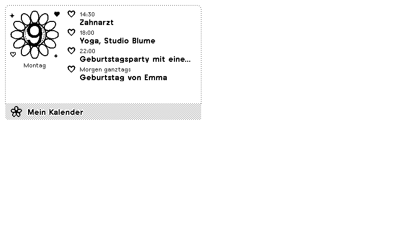

# Blossom Calendar

A sweet calendar for [TRMNL](https://trmnl.com) e-paper displays: today's date in the middle of a big blossom, little hearts and flowers around it, and the coming appointments with a heart in front of each one. Drawn in plain black and white, so it looks lovely on 1-bit screens too.



| Portrait | TRMNL X | Half (vertical) |
|---|---|---|
|  |  |  |

| Half (horizontal) | Quadrant |
|---|---|
|  |  |

## Features

- Today's weekday and date in a twelve-petal blossom, with hearts and sparkles around it
- The month at a glance: today sits in a heart, days with something on are underlined
- A flower vine, and a heart in front of every event
- Agenda for the next 3, 7 or 14 days: times, all-day events, multi-day events ("Day 2 of 3"), events past midnight
- Up to three calendars at once, from any iCal (ICS) link: Google, Apple iCloud, Outlook, Proton, Nextcloud
- Repeating events (daily, weekly, monthly such as "last Friday", yearly birthdays), skipped and moved dates, cancelled events
- German or English (or follow the TRMNL account language), 24-hour or 12-hour times
- All four TRMNL layouts (full, half horizontal, half vertical, quadrant), adapting to portrait, to TRMNL X and to dark mode
- Without a link it shows made-up example events

## Setup

Copy the secret iCal address of your calendar into the plugin settings:

- **Google Calendar**: Settings → your calendar → *Integrate calendar* → *Secret address in iCal format*
- **Apple iCloud**: Calendar app → share the calendar as *Public Calendar*, copy the link (`webcal://` works)
- **Outlook**: Settings → Calendar → *Shared calendars* → *Publish a calendar* → ICS link
- **Proton / Nextcloud**: share the calendar by link and copy the ICS address

Several calendars: separate the links with commas.

## How it works

1. A serverless transform fetches the iCal links and reads them with a small parser of its own, so it needs no extra package ([`src/transform.py`](src/transform.py)). TRMNL's polling would read `text/calendar` as JSON and drop it.
2. It expands repeats for this month and the days ahead, in your TRMNL time zone, and returns the days with their events and the month grid.
3. The views lay it out with TRMNL's framework classes; the blossom, hearts and vine are inline SVG in the page's ink, so they swap with dark mode ([`src/shared.liquid`](src/shared.liquid)).

## Development

Uses [trmnlp](https://github.com/usetrmnl/trmnlp) through Docker, no Ruby needed:

```sh
bin/trmnlp serve   # live preview at http://localhost:4567
bin/trmnlp lint
bin/trmnlp test
```

The preview shows the example events. With the `trmnl_preview` gem installed, `TRMNL_ICS_URL="https://…"` previews a real calendar without touching tracked files.

## License

[MIT](LICENSE)
