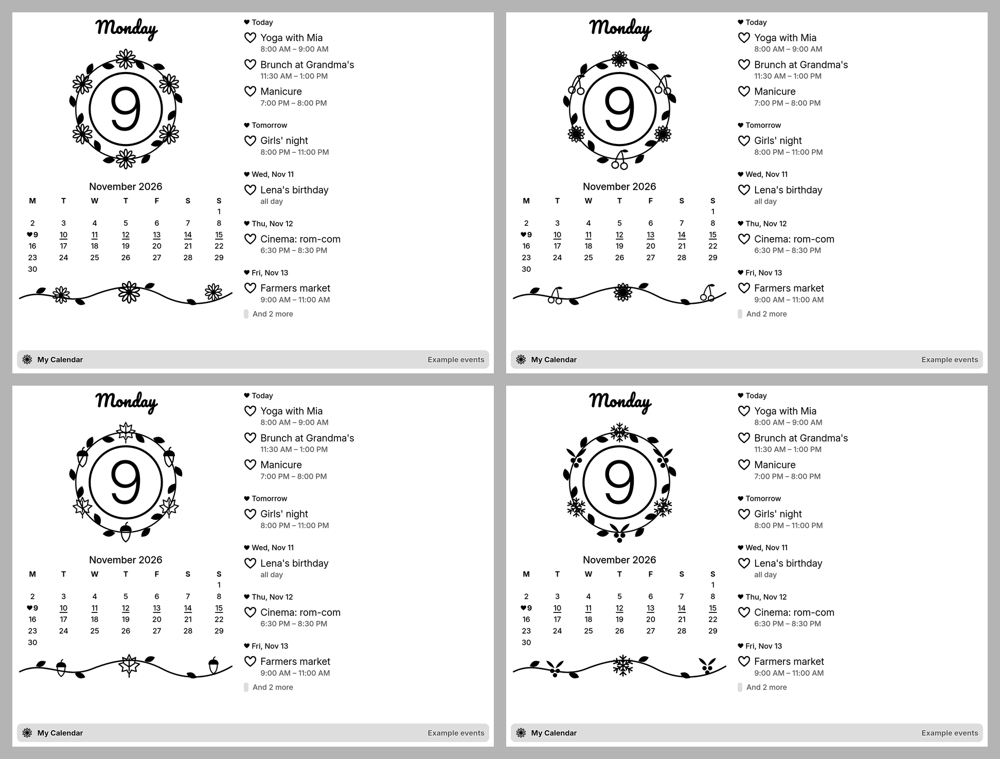

# Blossom Calendar

A sweet calendar for [TRMNL](https://trmnl.com) e-paper displays: today's date in a wreath of leaves and seasonal flowers, the weekday in a round script, a matching vine, and the coming appointments with a heart in front of each one. Drawn in plain black and white, so it looks lovely on 1-bit screens too.


| Portrait | TRMNL X | Half (vertical) |
|---|---|---|
|  |  |  |

| Half (horizontal) | Quadrant |
|---|---|
|  |  |

## Seasons



## Features

- Today's date in a wreath of leaves with the season's flowers, the weekday in [Pacifico](https://fonts.google.com/specimen/Pacifico) script
- Four motifs that change with the seasons, or one picked for good: daisies in spring, sunflowers and cherries in summer, maple leaves and acorns in autumn, snowflakes and holly in winter (turned half a year south of the equator)
- Holiday decoration, on unless switched off: stars and candles from 1 to 26 December, fireworks and four-leaf clover on New Year's Eve and Day, hearts and love letters from 12 to 14 February, pumpkins and ghosts from 25 to 31 October, tulips on Mother's Day (second Sunday in May), eggs and bunnies from the Monday before Easter to Easter Monday (Western Easter, worked out for every year)
- Your birthday (optional): cake, balloons and a greeting in the title bar
- The month at a glance: today with a little heart in front, days with something on are underlined
- A vine with the same motif, and a heart in front of every event
- Agenda for the next 3, 7 or 14 days: times, all-day events, multi-day events ("Day 2 of 3"), events past midnight; what already ended today drops off
- Your calendar from TRMNL's own calendar plugins (Google Calendar, Outlook, Apple Calendar, CalDAV with any iCal link), up to three at once
- German or English (or follow the TRMNL account language), 24-hour or 12-hour times (or as the calendar plugin shows them), the plugin's first day of the week
- All four TRMNL layouts (full, half horizontal, half vertical, quadrant), adapting to portrait, to TRMNL X and to dark mode
- Without a calendar it shows made-up example events

## Setup

1. Connect your calendar with one of TRMNL's calendar plugins: Google Calendar, Outlook, Apple Calendar, or CalDAV (which also takes any iCal link).
2. Give that plugin a week layout: a calendar plugin only shares the days its own layout shows.
3. Keep it in a playlist so it keeps refreshing. Hide it there (eye icon) if it shouldn't show on its own.
4. Install Blossom Calendar and pick the plugin under *Calendar* (and *Calendar 2*, *Calendar 3* for more).

## How it works

The recipe uses TRMNL's [Plugin Merge](https://help.trmnl.com/en/articles/12306729-using-data-mode-to-redesign-a-native-plugin) strategy, like [Pretty Calendar](https://trmnl.com/recipes/pretty-calendar-210616): TRMNL fetches the calendar, expands repeats and time zones, and hands the chosen plugins' events to this markup. Plugin Merge runs no serverless code, so [`src/shared.liquid`](src/shared.liquid) does the rest in Liquid: it spreads events over the days they cover, works out all-day and multi-day events, marks busy days in the month, and draws the wreath, daisies, hearts and vine as inline SVG in the page's ink, so they swap with dark mode.

## Development

Uses [trmnlp](https://github.com/usetrmnl/trmnlp) through Docker, no Ruby needed:

```sh
bin/trmnlp serve   # live preview at http://localhost:4567
bin/trmnlp lint
bin/trmnlp test
```

The preview shows the example events. The tests use made-up data in the shape the CalDAV plugin shares ([`tests/fixtures/caldav.json`](tests/fixtures/caldav.json)).

## License

[MIT](LICENSE)
